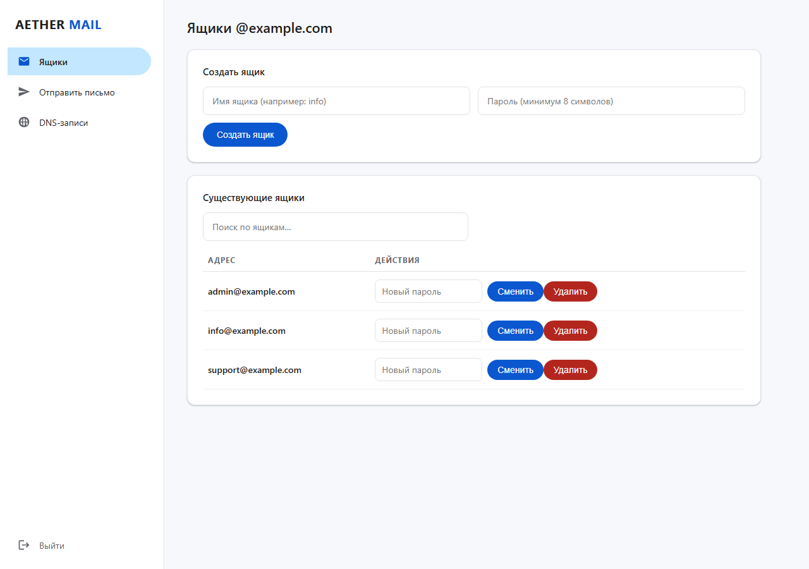
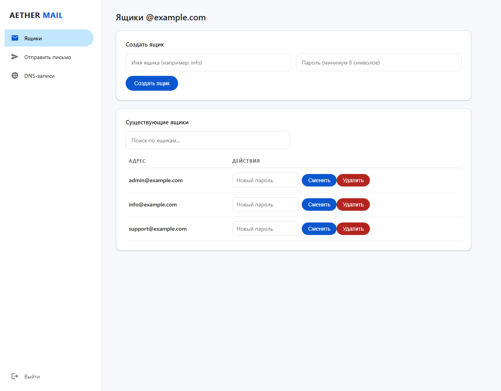
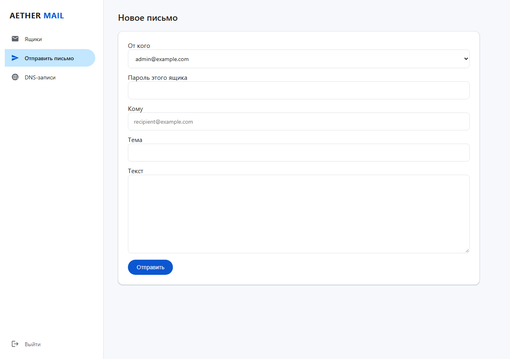
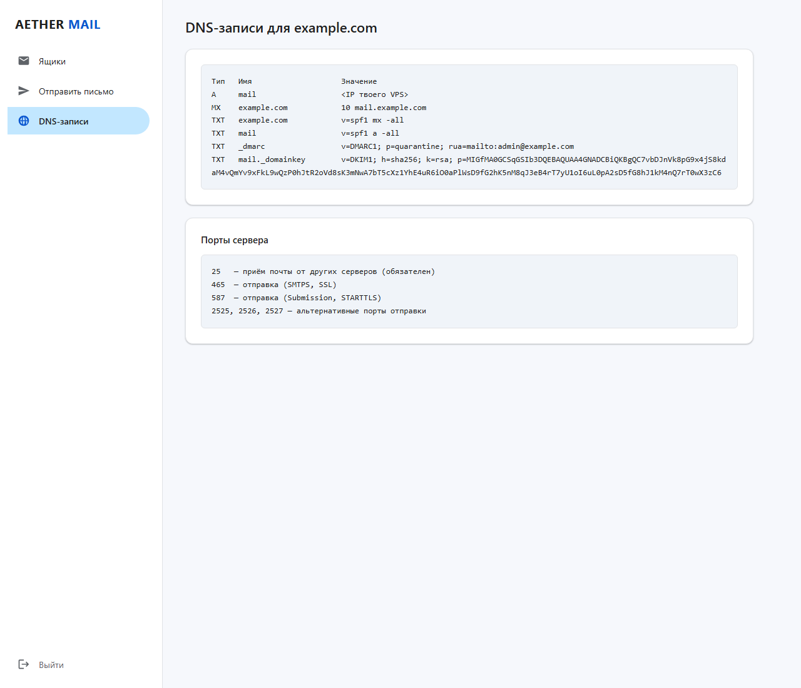

# AETHER MAIL

Почтовый сервер для собственного VPS с веб-панелью управления. Один скрипт — готовая почта с SSL, DKIM и файрволом.

## Что ставится

- **docker-mailserver** — SMTP-сервер (Postfix + Dovecot + OpenDKIM + OpenDMARC + Fail2ban)
- **Панель управления** (FastAPI) — ящики, пароли, отправка писем, DNS-справка
- **nginx** — HTTPS-прокси для панели
- **certbot** — SSL-сертификаты Let's Encrypt + автообновление через cron

## Порты

| Порт | Назначение |
|------|-----------|
| 25 | Приём почты от других серверов (нельзя закрывать) |
| 465 | Отправка (SMTPS, SSL) |
| 587 | Отправка (Submission, STARTTLS) |
| 2525, 2526, 2527 | Альтернативные порты отправки (проброс на 587) |
| 80, 443 | Панель управления (HTTP → редирект на HTTPS) |

## Структура репозитория

```
mailserver/
├── docker-compose.yml      # все сервисы
├── scripts/
│   └── install-mail.sh     # установка на чистый VPS одной командой
├── edge/
│   ├── panel/              # веб-панель управления (FastAPI)
│   └── nginx/              # прокси + заголовки безопасности
└── docs/
    └── screenshots/        # скриншоты интерфейса
```

## Установка на VPS

```bash
git clone https://github.com/SevaYa139/mailserver.git
cd mailserver
sudo bash scripts/install-mail.sh
```

Скрипт спросит:
1. **Домен почты** — например `example.com` (ящики будут `имя@example.com`)
2. **Поддомен панели** — например `panel` → панель будет на `https://panel.example.com`
3. **Пароль администратора** — если оставить пустым, сгенерируется случайный

**Перед запуском** убедись, что DNS A-записи `mail.<домен>` и `<поддомен>.<домен>` указывают на IP сервера — иначе certbot не получит SSL.

После установки скрипт выведет DNS-записи, которые нужно добавить (MX, SPF, DMARC, DKIM) — они также доступны в панели на странице `/dns`.

## Панель управления

`https://<поддомен>.<домен>` — вход по паролю администратора:

- **Ящики** — создание ящика с паролем, смена пароля, удаление, поиск по ящикам
- **Отправить письмо** — отправка от любого созданного ящика через SMTP с авторизацией
- **DNS-записи** — все записи для корректной доставки, включая публичный ключ DKIM

### Скриншоты

| Вход | Ящики |
|------|-------|
|  |  |

| Отправка | DNS-записи |
|----------|-----------|
|  |  |

## Безопасность

- Пароль администратора хранится как PBKDF2-хеш (200 000 итераций), сессии подписаны отдельным случайным секретом
- Защита входа от брутфорса: 5 попыток → блокировка на минуту, прогрессивные задержки
- CSRF-токены на всех формах, cookie HttpOnly + SameSite + Secure
- Заголовки безопасности в nginx: CSP, X-Frame-Options, X-Content-Type-Options, Referrer-Policy
- Fail2ban защищает SMTP от брутфорса
- Порт панели наружу не открыт — доступ только через nginx (443)
- `.env*`, сертификаты, почтовые данные и приватные ключи DKIM исключены из git

## Управление

```bash
docker compose ps                # статус
docker compose logs -f mailserver
docker exec mailserver setup email list   # список ящиков из консоли
docker exec mailserver setup email add user@example.com 'пароль'
docker exec mailserver setup config dkim  # пересоздать DKIM
```

## Дорожная карта (по спецификации PROJECT AETHER MAIL)

Текущая версия — рабочее ядро: почта + админ-панель. Дальше по плану:

- [ ] Миграция панели на Go API + Next.js клиент (спецификация §1)
- [ ] Stalwart Mail Server вместо docker-mailserver (SMTP/IMAP/JMAP)
- [ ] Пользовательские ящики с IMAP/Webmail: входящие, отправленные, черновики, папки
- [ ] PostgreSQL + Redis для аккаунтов и метаданных
- [ ] Регистрация, восстановление доступа, MFA (TOTP/WebAuthn)
- [ ] 7 языков интерфейса
- [ ] Rust-воркер проверки MIME и вложений, ClamAV
- [ ] Зашифрованные бэкапы с проверкой восстановления
- [ ] CI/CD: линтеры, тесты, сканирование образов
